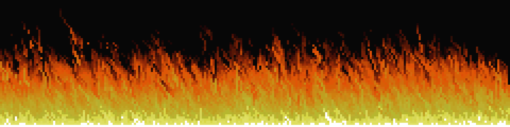

# Doom Fire

A small fun project: the classic Doom fire effect, rendered in the console or saved as an animated GIF.

It was written to remember the good old pre-AI days, when you coded things by hand just for fun.

## Setup

```
npm install
```

## Run

Console (runs until Ctrl+C):

```
npm start
```

Press `d` to toggle the fire on and off.

GIF (stops by itself after 100 frames unless `--frames` is set):

```
npm start -- --gif fire.gif
```

## Flags

| Flag | Default | Description | Example |
| --- | --- | --- | --- |
| `--fps <n>` | `20` | Frames per second | `npm start -- --fps 15` |
| `--width <n>` | `100` | Fire width in pixels | `npm start -- --width 80` |
| `--height <n>` | `60` | Fire height in pixels | `npm start -- --height 40` |
| `--gif <file>` | off | Save to a GIF instead of the console | `npm start -- --gif fire.gif` |
| `--frames <n>` | none (console), `100` (GIF) | Number of rendered frames | `npm start -- --gif fire.gif --frames 200` |
| `--start <n>` | `0` | Skip the first `n` frames before rendering | `npm start -- --gif fire.gif --start 50` |
| `--scale <n>` | `1` | Pixel block size in the GIF (needs `--gif`) | `npm start -- --gif fire.gif --scale 4` |

## Combined example

```
npm start -- --gif fire.gif --width 80 --height 40 --fps 15 --frames 150 --start 30 --scale 3
```
